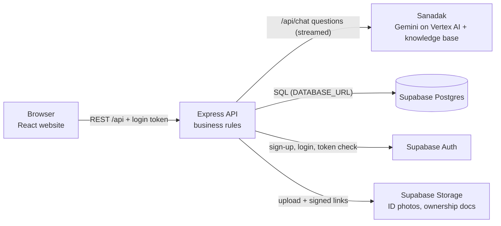

# Numrati: website (client)

> Part of **Numrati | نمرتي**, a marketplace for distinctive Jordanian license plates (HTU Capstone 2).
> Companion repository: [bashitii/numrati-server](https://github.com/bashitii/numrati-server), the Express API this website talks to.

React + TypeScript + Vite + Tailwind CSS. The site is bilingual (Arabic RTL and English) and talks only to the Numrati API (`../numrati-server`). It never connects to Supabase directly.

## Run it

Double-click **`Start Numrati.command`**. It starts the API and the website together and opens http://localhost:5173.

Or by hand, in two terminals:

```bash
cd ../numrati-server && npm run dev
```
```bash
npm install && npm run dev
```

## Structure

```
src/
  main.tsx            app entry: router, login state, favorites
  App.tsx             all routes (account/seller pages need login, /admin/* needs an admin)
  services/http.ts    fetch wrapper: adds the login token, renews it when it expires
  services/api.ts     one function per API call. Every page gets its data from here
  store/auth.tsx      signed-in user, login/register/logout, route guards
  store/favorites.tsx saved plates (kept on the server)
  pages/              screens: Auth, Browse, PlateDetails, Account, Seller, Estimate, Admin, Assistant
  components/         shared UI (buttons, fields, plate artwork, cards, layout)
  i18n/               Arabic and English text
```

## Settings

`.env.example` lists the optional setting `VITE_API_URL`, for when the API is hosted somewhere other than `localhost:4000`.

The Sanadak assistant page (`pages/Assistant.tsx`) sends questions to the API at `/api/chat`. The API asks Gemini on Vertex AI (with our knowledge base) and streams the answer back, so it appears word by word. Signed-in users get a history of their chats in the side panel. The website needs no AI key.

## Build

```bash
npm run build   # type-checks, then writes the static site to dist/
```

## Architecture (whole project)



- The website never talks to Supabase. Every request goes through the API, which checks who you are and whether you're allowed to do it.
- Row Level Security is on for every table with no policies, so Supabase's public Data API can't read or write anything. Only the server, connected directly to Postgres, can.
- Private files (ID photos, ownership documents) live in private buckets. Admins see them through links that expire after 10 minutes.

## Main features

- **Browse and search** plates by number, category, governorate, price and verified sellers.
- **Accounts**: email sign-up with a confirmation code, login, ID verification (ID front, back and a selfie).
- **Selling**: a 4-step listing wizard with an AI-suggested price and an ownership document upload. Listings wait for admin approval.
- **Buying**: favorites, chat with the seller, purchase requests that the seller can accept or decline.
- **Notifications** for messages, requests, price changes, approvals and rejections.
- **Price estimator**: rule-based valuation (the trained model can replace it later without changing the API).
- **Seller analytics**: views, interested buyers and requests over 7 days to 1 year.
- **Fraud protection**: every listing gets a risk score (price vs. market, account age, past rejections), shown to admins first.
- **Admin panel**: dashboard, ID verification queue, listing review, reports, bans and an audit log of every admin action.
- **Sanadak assistant**: answers questions about plates and DVLD procedures.
